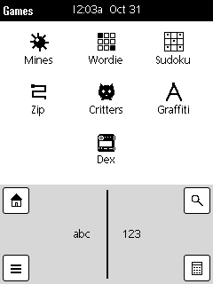
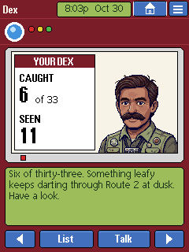
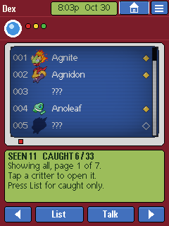
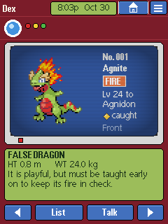
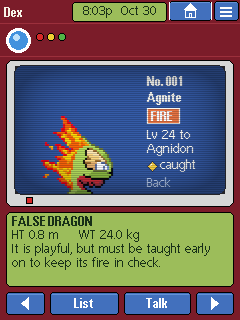
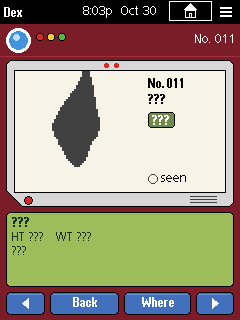
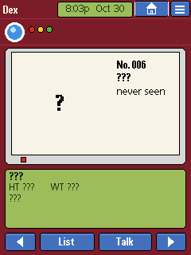
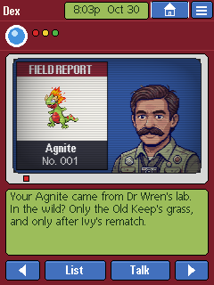

# Dex: plan (proposal, 2026-11-01; redesigned 2026-11-02; built 2026-11-03)

> **Status: built in the simulator, 2026-11-03** (phases D1 to D3, and §10's
> changes to Critters). **Nothing has run on the device yet:** D4, the bench, is
> the owner's, and the TV effect's speed and strength are measured there. Where
> the building changed the plan, the sections below say what was built. The
> owner asked (2026-11-01) for a new app in the Games folder, under Critters, named
> **Dex**. It works like the creature index in the monster-catching games:
> it lists every critter in the game, shows the ones the player has caught,
> and shows **???** for the rest.
>
> **The owner's redesign (2026-11-02):** the Dex is a **hardware gadget**. Its
> bezel and its keys never move or change, on any screen, and the title bar is
> part of them. All text is inside a subscreen, except what's printed on the
> hardware: the key labels and the name. The speaker comes through the
> subscreens too, so the speech bubble and portrait overlay of Coach and Guru
> **aren't used**. The owner supplied the speaker's art. §9 has the decisions,
> all made.
>
> **The owner's decision (2026-11-03):** the upper screen is a **TV**: TV blue,
> with a light CRT effect on that box alone (§2.4). A card on it keeps its own
> background. The same day they added slightly rounded corners on it, and the
> same effect and bezel for Critters' screen (§10; Critters later gave up the effect).

The mock-ups are in `docs/img/dex/`. They're 240×320, the device's size,
drawn by `tools/mock_dex.py` (a design aid, not product code) with the
firmware's Palm fonts and the Critters screens' colours, with the §2.4 effect
applied. Mock-up 1 is from the first design and is still right.

| | | | |
|---|---|---|---|
|  |  |  |  |
| 1. The Games folder | 2. Opening: the speaker | 3. The list | 4. A caught critter |
|  |  |  |  |
| 5. Back view | 6. Seen, not caught | 7. Never seen | 8. Where: the speaker |

## 1) What it is

- A **separate app**, not a screen inside Critters. It opens from the Games
  folder at any time, whether or not a game is running, and reads two
  files: the game (`/sdcard/games/monster/game.bin`) and the last save
  (`save.dat`). It never writes either of them.
- **A fixed gadget.** One bezel and one set of four keys, used by every screen.
  Only what's inside the two subscreens changes.
- **Every critter in the game file is listed**, numbered in Dex order
  (§4.2). Each has one of three states:
  - **caught**: everything is shown;
  - **seen** (met in battle, never owned): the sprite's silhouette, and ???
    for everything else;
  - **never seen**: a question mark, and ??? for everything else.
- **The speaker** opens the app with a line about the player's progress, and
  answers **Talk** on an entry. His lines are chosen by code from the player's
  state. It doesn't use a language model.

## 2) The gadget

The Dex is red, the Critters red (the A button's 123, 28, 41), so it reads
as a device within the game's world. Its details come from the reference
picture but are drawn our own way. It's a full-screen page like Study and Guru
(`ui_full_screen(1)`, so there's no Graffiti strip).

### 2.1 What never changes

| Part | Where (x, y) | Notes |
|---|---|---|
| **The title bar, as hardware** | 0–239, 0–23 | Same layout and dimensions as the system's; see below |
| The top strip: a lens and three lights | 0–239, 24–59 | No text. "No. 001" and the counts moved into the subscreens |
| The upper bezel, with one red light | 6–233, 60–206 | Grey, with clipped corners |
| **The upper screen**: a TV, blue, in colour (§2.4) | 15–224, 66–193 (**210×128**) | |
| **The lower screen**: green, in one ink colour | 7–232, 213–285 (**226×73**) | Five lines of text |
| **The four keys** | y 292–314 | **◀ List Talk ▶**, always these labels |

**Why the upper screen is 128 high.** In the first mock-ups it was 121. A
front or back sprite is drawn at 2×, and 8 of the 36 critters (measured before the wood and venom lines) are over 60 px
tall, up to 64 (`pigabyte`, `selmatek`, `dracune`, `propellercat`, `arthrobolt`,
`cateye`, `noctalo`, `djinnbo`; measured from their sheets). They'd lose up to
7 rows, so the grey bezel gives up that height. None is over 64 px wide, so a
2× sprite always fits the 128 px slot.

**The title bar** keeps every part where the system's puts it, so it stays
familiar, but it's drawn as part of the case:

| Part | Where (x, y) | As hardware |
|---|---|---|
| The name, Dex | From x 4 | Printed on the red case, in cream |
| The clock | Its usual centred place | Dark ink in a small green screen, x 72–166, y 2–21, sized for the widest clock so it doesn't change with the time |
| Home | 169–211, 1–20 | A blue key, with its usual icon in white |
| Menu | 214–238, 1–20 | A blue key, with its usual icon in white |

They do what they do everywhere else. Home leaves the app, and Menu opens the
system's menu. The menu and any system alert (a reminder, say) still appear over
the gadget while they're open, as they do over any app, and leave it unchanged.

The bezel is built **once**, when the app opens, and stays until it closes.
Moving between screens only refills the subscreens. `title_bar` belongs to the
whole system, so `content_clear()` must put it back when the Dex closes.

### 2.2 The keys

This set, with Home and Menu, is the gadget's whole keyboard. The labels never
change, and no key is ever dimmed or hidden (P4,
`PALM_ARCHIVE_REVIEW.md`). A key inverts while it's held, like Critters' A
button. What each one does depends on what the screens are showing:

| Key | The list | An entry | The speaker talking |
|---|---|---|---|
| **◀ ▶** | Previous or next page | Previous or next critter, skipping nothing | He stops, and the key acts on what's beneath |
| **List** | All critters or caught only, in turn | Back to the list, at this critter's page | He stops, and shows the list |
| **Talk** | His line about the player's progress | His line about where this critter lives | His next line (2026-11-04: so he can go on) |

The upper screen also takes taps, for what's shown there: a row opens that
critter, and a sprite turns it to its back and front again. Tapping either
subscreen while he's talking stops him, as with Guru's greeting.

This replaces the first design's two key sets (**Up Down Caught Talk** and
**◀ Back Where ▶**), where the labels changed from screen to screen. "Back"
was also a confusing label, since it looks like a way out.

### 2.3 The screens

1. **The Games folder** (mock-up 1). Dex is the seventh icon. The folder's
   grid is a wrapping flex row with even spacing, so a lone seventh icon
   sits **directly under Critters** without any layout code. The icon is a
   24×22 one-bit glyph like the others (`tools/gen_dex_icon.py`, as
   `gen_critters_icon.py`): a closed case with a lens.
2. **Opening** (mock-up 2). The speaker's line about the player's progress, with
   the counts on his card. The list is beneath it.
3. **The list** (mock-up 3).
   - **Upper screen:** rows of 24 px, the icon's height, so **five fit on a
     page**. Each shows the number, the critter's 24×24 icon, the name, and a
     mark: a solid gold diamond for caught, a hollow one for seen (§2.4). A Palm scroll bar
     shows the position.
   - A seen critter's icon is its silhouette, and its name is ???. A
     never-seen critter has no icon.
   - **Lower screen:** the counts (**SEEN 11  CAUGHT 6 / 46**), the filter and
     page ("Showing all, page 1 of 7"), and what to do next.
4. **An entry** (mock-ups 4 and 5).
   - **Upper screen:** the sprite at 2×, and beside it the number, the name,
     the type chips, the next evolution ("Lv 24 to Agnidon"), "caught", and
     which side is showing (Front or Back).
   - **Lower screen:** the category ("FALSE DRAGON"), the height and weight,
     and the description.
5. **Seen and never seen** (mock-ups 6 and 7). Everything is ??? except
   the number. A seen critter shows its silhouette, made at run time from the
   sprite's transparency (no new data). The keys behave as on any entry. Talk
   on an unknown critter gets "Nothing on this one yet."
6. **Where** (mock-up 8). Talk on an entry: the speaker says where the
   critter lives. The answer depends on the act, and comes from the game's
   encounter tables (§4.3).

**The description and his line use the same lower screen,** so a description
must fit in the three lines left under the category and the height and weight.
His lines get all five.

The caught and seen marks and the casing are our drawings. No logo, name or artwork
from the reference picture or the games it shows is used.

### 2.4 The upper screen is a TV

The owner's decision, 2026-11-03: the cream box didn't feel enough like a
screen. It's now TV blue with a light CRT effect, chosen from the mock-up
comparison. The lower screen stays a green LCD, so the two read as different
parts of the gadget.

**The colours**

| What | RGB |
|---|---|
| The screen's background | 38, 70, 140 |
| Its text | 244, 244, 236 |
| Its dim text ("Front", "Back") | 170, 192, 232 |
| A seen critter's silhouette | 12, 24, 60 |
| The dark well round the tube | 36, 36, 40 |
| The caught mark: a solid diamond, 11×11, with a small white glint | Gold 250, 196, 48, outlined 12, 24, 60 |
| The seen mark: the same diamond, hollow | Outlined 244, 244, 236 |

**A card keeps its own background, never TV blue.** Today that's the speaker's
news card (§3): cream (247, 243, 231) with black text, like a printed card held
up in a broadcast. Any later card follows the same rule.

**The effect** runs on the whole box, cards and portrait included, after
LVGL has drawn it. Nothing is drawn differently for it.

| Part | Amount |
|---|---|
| Sideways glow | Each pixel gains 30% of the average of its left and right neighbours, scaled by how much room its green has left |
| Scanlines | Every odd row of the box × 0.80 |
| A slight fade | × (1 − 0.06 × (dx² + dy²)), with dx and dy from −1 to 1 across the box: 6% down at a side's edge, 12% in a corner, in a checkerboard of rounding so it shows no bands |
| Black lift | One step of green and blue |

**The fade was 35% and d⁴ until the owner's bench report (2026-11-03):** "too much
brightness fade to the sides", worst on bright pictures (a battle, the Talk page's
card). It must be very subtle and gradual. A gate holds it: at Light, on cream, a
side's edge is within 2 of the 32 levels of the middle, with no jumps.

The strengths are Light (scan 0.90, 4%), Standard (0.80, 6%), Strong (0.70, 9%).

The corners of the box are rounded at radius 7, and the well round the tube
follows them at radius 8, so the rounding shows against the grey bezel (the
owner's ask, 2026-11-03). `crt_on()` is told both colours: the box's own corners
are squares, and painting them all in the well's colour left square dark corners
poking out of the rounded well (the owner, from the bench).
`firmware/main/crt.c` has the exact sums; `tools/mock_dex.py` the ideal ones.

**Where it runs.** In `flush_cb`, on the part of each strip inside the box,
before the byte swap. Each pixel reads only its own row, so it needs no copy of
the box and no history across LVGL's 40-row strips.

- **A change in the box redraws its whole rows,** or the glow leaves a seam at
  the edge of a partial redraw. `crt_widen()` does that on the display's
  `LV_EVENT_INVALIDATE_AREA`, so a key press outside the box costs nothing. A whole
  box is 26,880 pixels: about 14 ms at 160 MHz, computed from 82 cycles a pixel (`BUILD_PROGRESS.md`), which
  is nothing on a screen that doesn't animate.
- **Critters doesn't have the effect** (§10): `crt_plain()` keeps the rounded corners
  and leaves out everything else, with no widening.
- **The device and the simulator share the filter** (`crt.c`). They have separate
  `flush_cb`s, so it's one function both call, on only while the Dex or Critters
  is open (Critters for its corners).
- **It leaves the system alone.** While the menu or an alert is up, the effect skips
  the rectangle they cover and keeps the picture round them (the owner's ask,
  2026-11-03).
- **It isn't a copy of area512's filter** (`components/area512_hal/gfx/area512_crt.cpp`
  in `emu-commits/area512`), which we tried first. Its colour fringes made the
  Palm font hard to read, and its 3-pixel stripes would be about 1.7× coarser on
  this panel (about 143 pixels per inch against the Cardputer's 241). It also
  reads neighbouring rows, which would mean holding the box in memory (54 KB) or
  keeping history across strips.

**Critters on blue.** Measured on the 46 fronts, a median of 11% of a critter's
edge pixels are under 1.5:1 contrast with the background. The worst are Anoleaf
(87%) and Fluttaflap (71%), against 0% and 32% at worst on cream. **The mock-ups
don't show either one's sprite at full size yet; look at them on the panel in D4.**

**The strength is checked on the panel.** The scanlines are the part most likely
to look different on the real screen. Instead of a one-off test screen, the menu
has **TV effect: Light, Standard, Strong or Off**, in the Dex,
kept on the card (`games/tv.cfg`), so the owner can choose on the panel and keep
the choice. Standard is the mock-ups' strength. Off also answers "too slow".

## 3) The speaker

**The art** is the owner's, kept as `docs/img/dex/speaker/source.jpg`: a
dark-skinned man with a moustache in a khaki field vest, with badges and a
camera. It's pixel art on a grid of about 9.9 px in a 1024 px picture, so it's
really **102×102**. `docs/img/dex/speaker/colour_102.png` is that grid sampled
back to its pixels, with the backdrop set to the screen's TV blue and 24 colours
left. **It's in colour by the owner's choice:** a one-ink portrait can't show a
character who isn't light-skinned. Only its backdrop has been changed since, and from now
on that PNG is the art: edit it directly, and don't sample it from the JPEG again.

**His place, whenever he's talking** (mock-ups 2 and 8):

- **Upper screen:** he stands **against the right side**, at 1×, 102×102, on
  the screen's bottom edge. What he's talking about is on a **card to his left,
  like a news report's**: 103×122, cream with black text (its own background, §2.4), with a red heading band.
  - Opening: **YOUR DEX**, with the caught and seen counts.
  - On an entry: **FIELD REPORT**, with the critter's sprite at 1× and a caption
    band under it with its name and number. A seen critter shows its silhouette
    and ???, and a never-seen one a question mark and ???.
- **Lower screen:** his words, full width. That's about 38 characters by 5 lines.

The speech bubble and portrait overlay of the other apps aren't used. They sit
on top of the page, and nothing of the app's own may sit over this bezel or its
keys.

**Who he is.** He replaces the earlier proposal of Dr Wren, so the player no
longer gets coached by the game's final opponent. **His name is never shown**,
so none is needed, and the card and his lines don't refer to one.

**What he says.** The lines are chosen in `dex.c` (logic stays out of
`ui.c`) from the save and the game, with the same structure as
`st_advise()`. Each must fit in the lower screen (§7).

| When | Example |
|---|---|
| No save yet | "No keeper's licence, no Dex. Start a game in Critters first." |
| Opening, early | "Six of thirty-three. Something leafy keeps darting through Route 2 at dusk. Have a look." The hint names a critter **not yet seen** that the current act's tables can give, and the nearest area that has it. |
| Opening, a line not finished | "Your Vamporm's line has one left to find." |
| Opening, every one seen | "You've met them all. Catching them is another thing." |
| Opening, complete | "Thirty-three of thirty-three. I've nothing left to teach you." |
| Talk, caught, wild | "Route 2's grass and the Old Keep, levels 12 to 22." |
| Talk, keeper only | "No one's seen one wild. Ringwoman Juno keeps one; ask her." |
| Talk, the player's starter | "Yours came from Dr Wren's lab." |
| Talk, not caught | "Nothing on this one yet." |

**2026-11-04, the owner asked for a character, not a list of hints.** Each Talk on
the list moves on: what to do next, then a piece of who he is (14 pieces, each
opening at its share of the Dex, and told first on the catch that opens it), then
where he met one of the player's critters (30 memories, for caught ones only; a
second Talk on an entry gives that critter's). Close to done (three left, or a
tenth) he counts down; full, he looks back (7 lines).

They're written in the firmware (`dex.c`), like Guru's, because they're the speaker's
voice, not game data. **They're my drafts, for the owner to change.**

## 4) Data

### 4.1 What the save must remember (save version 4)

Today the save knows only the party and the box. A critter that was caught
and then evolved, released or traded no longer appears in either.

- **Two bitsets of 256 bits each** (64 B), *seen* and *caught*, keyed by
  the creature's **stable id** (`ids.tsv`), so that a rebuilt game file
  keeps the marks, and the first critter's id, for his "Yours came from Dr
  Wren's lab" (8 B more; `GAME_FORMAT.md` §7). This puts the save at version 4. Creature ids must stay
  under 256. The format's limit is written in `GAME_FORMAT.md` §5, and the
  builder refuses anything over it.
- `monster_play.c` sets the marks at these points:

  | Event | Seen | Caught |
  |---|---|---|
  | A wild encounter starts (`MP_EV_ENCOUNTER`) | ✓ | |
  | A keeper sends out a critter (`MP_EV_SENDS`) | ✓ | |
  | The player catches one (`MP_EV_CAUGHT`) | ✓ | ✓ |
  | The player receives a starter | ✓ | ✓ |
  | One of the player's critters evolves (`MP_EV_EVOLVE`) | ✓ | ✓ |

  This follows the games: evolving a critter registers its new form.
- **A version 3 save** loads with both sets made from the party and the
  box, so that a player's existing progress shows straight away.
- **The Dex reads `save.dat` only.** Opening any screen clears the content
  area, and that closes Critters and saves it (`content_clear()` calls
  `mon_ui_close()`). So by the time the Dex opens, the save is current, and
  the two never hold the game at once.

### 4.2 What the game file must add (format 2.2, minor)

A 2.1 reader skips both sections, so the game still plays on older
firmware. A 2.2 Dex shown an older file lists names and sprites and shows
"no Dex data in this file" in the panel.

- **`DEXE`, one 24 B record per creature, in `MONS` order** (16 B was a slip: a
  `TEXT` reference is 8 B):
  - the Dex number (u16);
  - the height in cm (u16) and the weight in tenths of a kg (u16, so up to
    6,553.5 kg; Agnigon is 2,000);
  - the category (a `TEXT` reference);
  - the description (a `TEXT` reference);
  - 2 B reserved.
- **`ICON`, the 24×24 list icons:** the sheets' first menu frame, 4-bit with
  its own 15-colour palette: 320 B a creature, about **14.7 KB** for 46.
- **The source.**
  - Height, weight and category come from Tuxemon's monster data.
  - The description comes from Tuxemon's English text. **All 27 have one**
    (the "13 of 27" here earlier was wrong). `mkgame.py` refuses a description
    past the lower screen's three lines, so **five were shortened** in
    `game_region.json` (Agnigon, Arthrobolt, Dune Pincher, Nut, Selmatek), and
    **13 of our own critters' descriptions in `tools/game_creatures/` were cut**
    to fit. Our critters' categories and sizes are new. All of those are my
    drafts, for the owner's review.
  - The **Dex order** is a `"dex"` list in `game_region.json`: the starters'
    lines first, then the rest in the order a player meets them. The owner
    controls that order, and new critters are added to it.
- **Both dumps** (`mkgame.py --dump`, `monster_test.c`) print the new
  sections. The round trip compares them byte for byte, as now.

**Cost: 20,176 B**, 3 % of the 653,980 B file (now 674,156 B).

### 4.3 Where: worked out, not stored

The **Where** line is computed when it's asked for:

- go through the areas' zones and the encounter tables they name, through
  the act's table steps (`META` 0x14, the save's flags);
- collect the areas and level ranges that give the critter;
- separately, list the keepers whose teams include it, and note whether it's
  the player's starter.

No new data is needed, and it's correct for whichever act the save is in.

## 5) Memory

The Dex obeys the same rule as the other screens: **one heap block, taken
when the app opens and freed when it closes.** It adds **no static DRAM**.

| What | Size |
|---|---|
| The open game file's directory and the save's header and bitsets | about 1 KB |
| One entry's sprite, kept 4-bit as it is on the card and scaled as it's composed | 4.1 KB |
| The page's icons, kept as they are on the card: five at 320 B | 1.6 KB |
| One band of the upper screen, as Critters' view has (below) | 19.2 KB |
| The whole gadget: **one LVGL object**, drawing everything itself | under 1 KB of the LVGL pool |
| The speaker's portrait: RGB565 with no alpha, 20.8 KB of flash, drawn from there | none |
| The largest area head, only during a Where search or his opening | a few KB, for that moment |
| **Total, measured in the simulator's tour** | **28,080 B of heap** |

**Built differently from this plan's first table:** the upper screen has no
`lv_image`s at all. Each draw composes the band LVGL is drawing into one buffer,
as Critters does, which is less memory than decoding a sprite and five icons with
alpha, and adds almost nothing to the pool. There's about 106 KB of heap free with
the SD card mounted. The smoke tour's `B` and `E` commands prove the heap is given
back, as they do for Study.

## 6) Code

| File | What |
|---|---|
| `firmware/main/dex.c`, `dex.h` | New. Opening the game and the save read-only; the Where search (§4.3); the speaker's lines (§3). No LVGL. |
| `firmware/main/ui_dex.c`, `ui_dex.h` | New, as `ui_monster.c` is for the game: the gadget and its screens. |
| `firmware/main/crt.c`, `crt.h` | New. The TV effect (§2.4); Critters uses only its corners (§10). |
| `firmware/main/ui.c` | The hardware title bar (restyled on opening, put back by `content_clear()`), the seventh Games icon, and the menu's TV effect item. It doesn't use the speech-bubble code. |
| `firmware/main/monster.c`, `.h` | Reads `DEXE` and `ICON` (2.2). `mg_dex()` and `mg_icon()`. |
| `firmware/main/monster_play.c`, `.h` | The marks, save version 4, and loading a version 3 save. |
| `firmware/main/dex_art.c` | `icon_dex` and the speaker's portrait, generated by `tools/gen_dex_art.py`, which reads `colour_102.png` 1:1 and is checked by `tests/mkgame_test.py`. |
| `firmware/main/lvgl_port.c`, `sim/sim_port.c` | Both `flush_cb`s call the one TV filter (§2.4). |
| `tools/palm_font.py` | The Palm fonts, for the mock-ups, `mkgame.py`'s description check and the fit gate. |
| `tools/mock_dex.py` | Draws the mock-ups. Not product code. |
| `tools/mkgame.py` | Format 2.2: `DEXE` and `ICON`, the `"dex"` order, the description source, and the dump. |
| `tools/game_region.json` | The `"dex"` order and the 14 written descriptions. |
| `docs/GAME_FORMAT.md` | The two sections, the save at version 4, and the id limit. |

## 7) Gates

- **`make -C sim dex`** (new, in `ci.yml` and CLAUDE.md's list):
  - the marks are set by each event in §4.1;
  - a version 3 save upgrades correctly;
  - the Where search, for each act, matches the answers `tests/dex_check.py`
    works out from `mkgame.py`'s separate reader of the same file;
  - the speaker's choice of line for each state;
  - **every line fits**: each line and each worked-out Where answer wraps to at
    most five lines of the lower screen in the Palm font, and every description
    to at most three.
- **`make -C sim monster`:** the existing bot gate, with save version 4. Auto-play's
  full run must end with every critter it met marked seen and every critter it
  owned marked caught.
- **`tests/mkgame_test.py`:** `DEXE` and `ICON` on the fixture,
  byte-for-byte rebuilds, and a refusal for a creature id of 256 or more.
- **Smoke shots:**
  - `dex_folder`, `dex_greet`, `dex_list`, `dex_list_p2`, `dex_list_caught`;
  - `dex_entry_caught`, `dex_entry_back`, `dex_entry_seen`, `dex_entry_never`;
  - `dex_where`;
  - `dex_tall`, a critter 64 px tall, to see that it isn't clipped;
  - `dex_no_save`, the first run with no game played.

  The bezel, title bar and keys are **pixel-identical** on all of them:
  `sim/tests/dex_regions.py`, at the end of `make -C sim smoke`, compares those
  regions (bar the clock). A further shot, `dex_left`, leaves for the launcher, and
  must show the system's own black title bar again.

  A smoke command `D <seen-ids> <caught-ids>` will write a save with those
  marks, as the `F` command sets flags and coins.
- Every gate in CLAUDE.md before each commit, the firmware build, and the
  static DRAM checked unchanged.

## 8) Phases

- **D1, the data. Done 2026-11-03.** Format 2.2 (`DEXE`, `ICON`, the order, the
  shortened descriptions), save version 4 with the marks, `make -C sim dex` for
  the marks, and the dumps.
- **D2, the app, and D3, the speaker. Done 2026-11-03, in one commit** (the screens
  and his card share a draw): the fixed bezel and keys, `dex.c` and the screens,
  the Games icon, the smoke shots, the Where search, the portrait and the news
  card, the lines, their fit gate, and the measured heap.
- **D4, the bench. The owner's, not started.** The `[d]` items: the Dex opens from the folder;
  a caught critter shows in full after a save; a v3 save keeps its party in
  the Dex; the heap is unchanged after closing; ◀ ▶ are fast enough on the
  board; the keys are easy to hit; the portrait and the green clock read well on
  the panel; small text is readable through the TV effect; Anoleaf and
  Fluttaflap hold up on the blue.

Separately, and not part of the Dex: **the owner's new critters.** Built
2026-11-01 (`tools/game_creatures/README.md`): `tools/mksheet.py` turns a
drawing into its sheet, and a creature of our own has its rules in
`tools/game_creatures/<slug>.yaml` and an allow-list line with status
"ours". The first are the fire fox line (Cinderkit, Scorchvix, Pyrewing) and
the axolotl line (Gillpip, Rillotl, Maelstrotl), then the lightning line
(Sparkip, Nimbolt, Fulminax), and the wood and venom lines (Sprigling, Wildbough, Grovarch; Skullick, Ossicoil, Banewyrm), the sky line (Cirrup, Cumulynx, Tempyre) and Rivetron, so the game has **46** critters now, not the 27 counted below; their
descriptions are in their rules, ready for the Dex. Who uses them in Acts 2
and 3 is still open: today they're only wild.

## 9) Decisions

**Decided by the owner, 2026-11-02:**

- The bezel and keys are fixed, all other text is in the subscreens, and the
  bubble overlay isn't used.
- **The speaker:** in colour in the upper screen, against its right side, with
  the content in a news-report card to his left, and his words in the lower
  screen (§3). He has no displayed name. The art is the owner's latest variant.
- **The title bar** is redrawn as part of the hardware, in the same layout and
  dimensions (§2.1).
- **The keys:** ◀ List Talk ▶, so caught-only is a second press of List and
  turning a sprite is a tap (§2.2).

**Decided by the owner, 2026-11-03:**

- **The upper screen is a TV:** TV blue, with the light CRT effect on that box
  alone (§2.4; panel 4 of the comparison), rather than area512's filter as it is.
- **A card on it has its own background,** not TV blue. The owner didn't name
  the colour: the plan uses the old screen cream, to be changed if they prefer.

- **The caught and seen marks are diamonds,** not a ball: the owner's call, because
  a ball looked too much like existing intellectual property (§2.4). A caught
  diamond is solid gold, and a seen one hollow.

**Taken on the recommendations, the owner's word, 2026-11-02:**

- **A critter seen but not caught** shows its silhouette, with ??? for everything
  else, as in the games.
- **The list has the 24×24 icons**, about 15 KB in the file for 46 critters.
- **The Dex order:** the starters' lines first, then in the order a player meets
  them.
- **The missing descriptions:** I draft them for the owner's review. They must fit
  three lines of the lower screen.
- **The format change:** game format 2.2 and save version 4, both additions that
  older firmware handles: it skips the new sections, and an older save is
  upgraded.

- **The rest of the plan, and §10:** "build through the DEX_PLAN.md", the owner,
  2026-11-03.

The only thing left to choose is the effect's strength, on the panel (§2.4).

## 10) Critters' screens (the owner's additions, 2026-11-03)

These change the game, not the Dex, and were built with it.

- **Critters' game screen has a thin retro bezel and slightly rounded corners**
  (radius 6). The bezel is 4 px, so the picture is now **232 × 172**, from 240 × 176:
  the map shows 8 px less across and 4 px less down, and the battle's layout moved a
  few pixels to suit.
- **It has no TV effect: given up, on the bench** (the owner, 2026-11-03). Their order
  was to optimise it, else replace it with something cheaper, else drop it from
  Critters. The full effect cost 17 ms of every walking frame even after rewriting it;
  a cheaper form (scanlines and the fade, no glow, 2 ms) ran well on the board, but
  the game's text was unreadable through it, which the Dex's text isn't. So Critters
  keeps only the corners (`crt_plain()`), and has no TV effect item in its menu.
- **The controller has a thin retro bezel.** A faceplate with rounded corners on a
  dark body, the colour of the screen's bezel, so the two read as one case. The
  panel is 116 px high, from 120, which still fits the D-pad at its full size (its
  centre and A and B moved 2 px); it's at the same place to a finger.
- **The party screens have the critters' icons,** the 24 × 24 ones of §4.2.
  - **Party** (and every menu that picks a critter: Swap, and using an item): a
    line is 24 px, from 14, with the icon beside the name. Six critters and Back
    just fill the screen.
  - **Auto-play's panel:** two columns of three, each with the icon, name, level,
    HP and a bar. Six rows of 24 px wouldn't fit 116 px.
  - The icons are drawn from 6.9 KB of heap, taken the first time they're shown
    and freed when the game closes. A file without `ICON` shows the screens
    without them.
- **A bug this found:** a band of the view was capped at 40 rows, but a strip
  narrower than the screen can be taller (45 rows at 210 px). The band is now
  capped by pixels.
